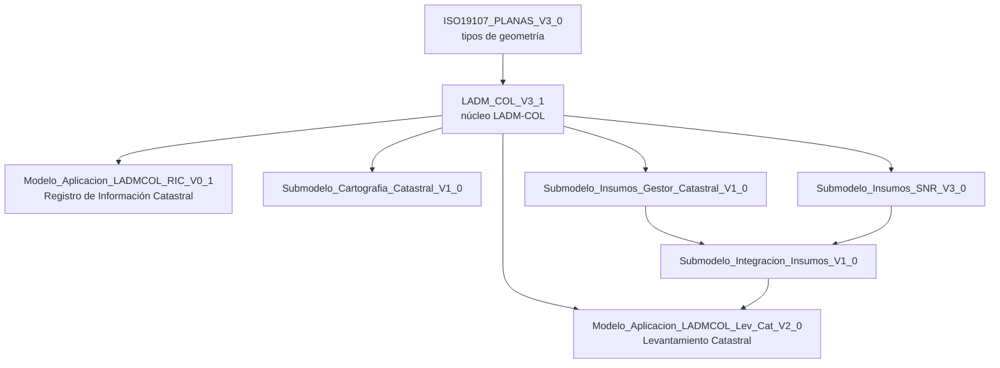
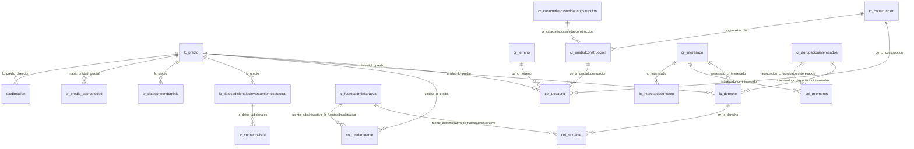

# Datos del proyecto: base catastral en LADM-COL

Este documento describe la base de datos que sirve de fuente al proyecto: qué es, de dónde sale su estructura, cómo están organizadas sus tablas y qué documentación la acompaña. No describe todavía el contenido de los datos (cantidades, calidad, distribuciones); eso corresponde al entendimiento de los datos y se documentará aparte.

De las 217 tablas de la base, 117 están vacías. Para trabajar con los datos está la **base podada**, una copia con las 45 tablas que tienen contenido útil: su criterio, su diagrama entidad-relación, su diccionario de datos y el script que la crea están en [base-podada/](base-podada/README.md).

## Qué es

Es una base de datos PostgreSQL con PostGIS que contiene el levantamiento catastral de un municipio colombiano, estructurado según **LADM-COL**, el perfil colombiano de la norma ISO 19152 (*Land Administration Domain Model*). LADM-COL es el modelo que el Instituto Geográfico Agustín Codazzi (IGAC) y la Superintendencia de Notariado y Registro (SNR) definieron para intercambiar información de catastro y registro en Colombia.

| Aspecto | Valor |
| --- | --- |
| Motor | PostgreSQL 18.6 con PostGIS 3.6.4 y `uuid-ossp` |
| Base de datos | `xtf2` |
| Esquema | `xtf` (el esquema `public` solo tiene la tabla `spatial_ref_sys` de PostGIS) |
| Tablas | 217 |
| Sistema de coordenadas | EPSG:9377 (MAGNA-SIRGAS, Origen Nacional) |
| Carga actual | Un solo conjunto de datos: el levantamiento catastral de un municipio colombiano |
| Tema cargado | Solo `Levantamiento_Catastral`, del modelo de aplicación de Levantamiento Catastral V2.0 |

La información catastral llegó en un archivo de transferencia INTERLIS (`.xtf`, un XML) y se cargó a PostgreSQL con **ili2pg 5.5.1**. Esa herramienta lee los modelos INTERLIS (archivos `.ili`), crea a partir de ellos las tablas y luego importa el `.xtf`. Por eso la estructura de la base no fue diseñada a mano: es una traducción automática de los modelos que están en [modelos-ladm-col/ili/](modelos-ladm-col/ili/).

## De dónde sale el modelo

Los siete archivos `.ili` de [modelos-ladm-col/ili/](modelos-ladm-col/ili/) son exactamente los que se usaron para crear el esquema: su contenido coincide (mismo MD5) con el que ili2pg guardó en la tabla `xtf.t_ili2db_model`.

Un archivo `.ili` puede contener varios modelos, y los modelos se importan entre sí:



| Archivo | Modelo | Versión (fecha en el archivo) | Qué describe | Prefijo de sus tablas |
| --- | --- | --- | --- | --- |
| `Modelo_Aplicacion_LADMCOL_Lev_Cat_V2_0.ili` | `Modelo_Aplicacion_LADMCOL_Lev_Cat_V2_0` | V2.0 (2022-12-30) | **Modelo principal.** El levantamiento catastral: predios, terrenos, construcciones, interesados, derechos y fuentes | `lc_`, `cr_` |
| `LADM_COL_V3_1.ili` | `LADM_COL_V3_1` | V3.1 (2020-08-13) | Núcleo LADM-COL: las clases abstractas de las que heredan los modelos de aplicación, sus relaciones y sus dominios | `col_`, `ext`, y algunas sin prefijo |
| `Modelo_Aplicacion_LADMCOL_RIC_V0_1.ili` | `Modelo_Aplicacion_LADMCOL_RIC_V0_1` | V2.2.1 según el archivo | Registro de Información Catastral | `ric_` |
| `Submodelo_Insumos.ili` | `Submodelo_Insumos_Gestor_Catastral_V1_0` | 2019-08-01 | Insumos del gestor catastral: la información catastral que el gestor entrega como insumo | `gc_` |
| `Submodelo_Insumos.ili` | `Submodelo_Insumos_SNR_V3_0` | V3.0 (2022-12-30) | Insumos de la SNR: información registral (folios de matrícula, titulares, derechos, anotaciones) | `snr_` |
| `Submodelo_Insumos.ili` | `Submodelo_Integracion_Insumos_V1_0` | 2019-09-06 | Emparejamiento entre el predio catastral y el predio registral de los insumos | `ini_` |
| `Submodelo_Cartografia_Catastral_V1_0.ili` | `Submodelo_Cartografia_Catastral_V1_0` | V1.0 (2018-04-19) | Cartografía de referencia: barrios, veredas, manzanas, perímetros, nomenclatura vial | `cc_` |
| `ISO19107_PLANAS_V3_0.ili` | `ISO19107_PLANAS_V3_0` | 2016-03-07 | Tipos de geometría (curvas, superficies) | `gm_` |
| `INTERLIS_TOPOLOGY.ili` | `INTERLIS_TOPOLOGY` | 2017-09-19 | Funciones de topología; no genera tablas | — |

Los modelos son del IGAC y la SNR (así lo declaran sus encabezados). Los archivos de esta carpeta tienen ajustes menores frente a los publicados oficialmente; **esos ajustes aún no están documentados** (ver [Pendientes](#pendientes)).

Los encabezados de `Modelo_Aplicacion_LADMCOL_Lev_Cat_V2_0.ili` y del modelo de la SNR dentro de `Submodelo_Insumos.ili` traen el registro de cambios frente a la versión anterior (clases, atributos y dominios eliminados, agregados o renombrados), útil para entender por qué algunas clases empiezan por `CR_` y otras por `LC_`.

## Documentación que acompaña a los modelos

Todo está en [modelos-ladm-col/documentacion/](modelos-ladm-col/documentacion/), aparte de los archivos `.ili`.

| Archivo | Qué es | Para qué sirve |
| --- | --- | --- |
| `Diccionario_de_Datos_Modelo_de_Aplicacion_de_Levantamiento_Catastral_v2_0.pdf` | Diccionario de datos del IGAC (60 páginas, enero de 2023) | Es la referencia para saber qué significa cada clase, atributo y valor de dominio |
| `Modelo_Aplicacion_LADMCOL_Levantamiento_Catastral_V2_0.png` | Diagrama de clases del modelo principal (6623 × 4678 px) | Ver de un vistazo las clases, sus atributos y cómo se relacionan |
| `Modelo_Aplicacion_LADMCOL_Levantamiento_Catastral_V2_0.pdf` | El mismo diagrama en PDF (una página, tamaño A1) | Imprimir o ampliar sin perder nitidez |
| `Modelo_Aplicacion_LADMCOL_Levantamiento_Catastral_V2_0.uml` | Fuente del diagrama, en el formato del editor UML de INTERLIS (*UML/INTERLIS-Editor*) | Editar el diagrama; no hace falta para trabajar con los datos |

### Cómo leer el diccionario de datos

- Está organizado por los paquetes de LADM: **Administrativo** (unidad administrativa básica; derechos, responsabilidades y restricciones), **Interesados**, **Unidad Espacial** y su subpaquete de **Topografía y Representación**. Dentro de cada uno van primero las clases, luego las estructuras, los dominios y las relaciones.
- Para cada clase da una tabla con: atributo, alias, descripción, obligación o condición (la cardinalidad: `1`, `0..1`, `0..*`, `1..*`), tipo de dato y dominio.
- Cubre el modelo principal, las clases del núcleo que hereda (`COL_`) y también los submodelos de insumos (`GC_`, `SNR_`, `INI_`) y de cartografía (`CC_`). **No cubre el modelo RIC**: para sus tablas `ric_` la única documentación son los comentarios del archivo `.ili`.
- Los nombres del diccionario son los del modelo (`LC_Predio.Numero_Predial`). En la base aparecen en minúscula (`lc_predio.numero_predial`); la sección siguiente explica las demás diferencias.

Además del diccionario, cada clase, atributo y valor de dominio tiene su descripción como comentario (`/** ... */`) en el archivo `.ili`, y la base guarda parte de esa documentación (ver [Tablas de metadatos](#tablas-de-metadatos-de-ili2db)).

## Cómo se traduce el modelo a tablas

Estas reglas salen de la configuración con que se creó el esquema (tabla `xtf.t_ili2db_settings`) y explican casi todo lo que sorprende al abrir la base.

**Tipos de tabla.** Cada tabla sale de un elemento del modelo:

| Tipo | Tablas | Qué contiene |
| --- | --- | --- |
| Clase | 85 | Los objetos del modelo: un predio, un terreno, un interesado |
| Estructura | 26 | Atributos compuestos o repetidos de una clase (por ejemplo, las direcciones de un predio). Cada fila apunta a su dueño con una llave foránea |
| Asociación | 26 | Relaciones de muchos a muchos entre clases |
| Dominio | 70 | Listas de valores permitidos (enumeraciones), una tabla por dominio |
| Metadatos | 10 | Tablas `t_ili2db_*` que crea ili2pg |

**Nombres.** El nombre de la tabla es el de la clase en minúscula. Los nombres de más de 60 caracteres se abrevian quitando vocales, así que hay columnas como `lc_n_spcjrdcndddfccion_area`.

**Columnas comunes.**

| Columna | Qué es |
| --- | --- |
| `t_id` | Llave primaria (entero), propia de la base. Todas las llaves foráneas apuntan a ella |
| `t_ili_tid` | Identificador del objeto en el archivo de transferencia (UUID) |
| `t_basket` | A qué carga pertenece la fila (apunta a `t_ili2db_basket`) |
| `espacio_de_nombres`, `local_id` | Identificador del objeto según LADM |
| `comienzo_vida_util_version`, `fin_vida_util_version` | Vigencia de la versión del objeto |

**Herencia.** Las clases abstractas del núcleo (`COL_UnidadAdministrativaBasica`, `COL_Interesado`, `COL_UnidadEspacial`, entre otras) no tienen tabla. Sus atributos aparecen como columnas en las tablas de las clases concretas que las heredan: `lc_predio`, por ejemplo, tiene las columnas `nombre` y `tipo`, que vienen de `COL_UnidadAdministrativaBasica`.

**Asociaciones del núcleo.** Como las relaciones del núcleo se definen entre clases abstractas, sus tablas (`col_*`) tienen una columna por cada clase concreta que puede participar. `col_uebaunit`, que une predios con sus unidades espaciales, tiene `baunit_lc_predio` y `baunit_ric_predio` de un lado, y `ue_cr_terreno`, `ue_cr_construccion`, `ue_cr_unidadconstruccion` y otras del otro. En cada fila se llena la columna de la clase que corresponde y las demás quedan vacías.

**Relaciones de uno a muchos.** No tienen tabla propia: son una llave foránea en la tabla del lado "muchos". Por ejemplo, `cr_unidadconstruccion.cr_construccion` apunta a la construcción a la que pertenece la unidad.

**Dominios.** Los atributos de tipo enumeración guardan el `t_id` de una fila de la tabla del dominio, no el texto. Para obtener el valor hay que unir con esa tabla, que tiene `ilicode` (el código del modelo), `dispname` (el nombre para mostrar) y `description`:

```sql
SELECT p.numero_predial, c.dispname AS condicion
FROM xtf.lc_predio p
JOIN xtf.lc_condicionprediotipo c ON c.t_id = p.condicion_predio;
```

**Geometrías.** Están en columnas de PostGIS, casi siempre llamadas `geometria`, en EPSG:9377 y en su mayoría con tres dimensiones. Usan tipos con curvas (`MULTISURFACE`, `COMPOUNDCURVE`, `CURVEPOLYGON`) en lugar de `MULTIPOLYGON` o `LINESTRING`; algunas librerías no los leen directamente y hay que convertirlos antes con `ST_CurveToLine`.

## Tablas

### Modelo principal: Levantamiento Catastral

Es la parte de la base que tiene los datos del levantamiento. Las descripciones vienen de los comentarios del modelo.

| Tabla | Clase del modelo | Qué representa |
| --- | --- | --- |
| `lc_predio` | `LC_Predio` | El predio, unidad territorial legal del catastro. Está formado por el terreno y puede o no tener construcciones |
| `lc_datosadicionaleslevantamientocatastral` | `LC_DatosAdicionalesLevantamientoCatastral` | Datos adicionales del predio para el catastro multipropósito |
| `lc_contactovisita` | `LC_ContactoVisita` | Datos de quien atendió la visita de levantamiento (sin descripción en el modelo; se deduce de sus atributos) |
| `cr_terreno` | `CR_Terreno` | Porción de tierra con una extensión geográfica definida |
| `cr_construccion` | `CR_Construccion` | Unión de materiales adheridos al terreno con carácter permanente |
| `cr_unidadconstruccion` | `CR_UnidadConstruccion` | Cada conjunto de materiales consolidados dentro de un predio con características físicas y de uso propias |
| `cr_caracteristicasunidadconstruccion` | `CR_CaracteristicasUnidadConstruccion` | Agrupa las unidades de construcción por identificador, uso y tipología |
| `cr_datosphcondominio` | `CR_DatosPHCondominio` | Datos principales del predio matriz sometido a propiedad horizontal |
| `cr_interesado` | `CR_Interesado` | La parte que tiene una relación con el predio por algún derecho, restricción, publicidad o responsabilidad |
| `cr_agrupacioninteresados` | `CR_AgrupacionInteresados` | Agrupación de interesados (hereda de `COL_AgrupacionInteresados` del núcleo) |
| `lc_interesadocontacto` | `LC_InteresadoContacto` | Datos de contacto del interesado |
| `lc_derecho` | `LC_Derecho` | El derecho que un interesado ejerce sobre un predio |
| `lc_fuenteadministrativa` | `LC_FuenteAdministrativa` | Los documentos (escrituras, sentencias, actos administrativos) que sustentan el derecho |
| `cr_fuenteespacial` | `CR_FuenteEspacial` | Fuente espacial (hereda de `COL_FuenteEspacial` del núcleo) |
| `cr_lindero` | `CR_Lindero` | Línea de división que separa un bien inmueble de otro |
| `cr_puntolindero` | `CR_PuntoLindero` | Punto que define la frontera de un predio con otro |
| `cr_puntocontrol` | `CR_PuntoControl` | Puntos topográficos o geodésicos usados como amarre del levantamiento |
| `lc_nu_agrupacionunidadesespaciales`, `lc_nu_caraslindero`, `lc_nu_espaciojuridicoredservicios`, `lc_nu_espaciojuridicounidadedificacion`, `lc_nu_nivel`, `lc_nu_relacionnecesariabaunits`, `lc_nu_relacionnecesariaunidadesespaciales` | `LC_NU_*` | Clases del núcleo LADM que el modelo extiende sin agregarles atributos ni descripción |

Estructuras (atributos compuestos):

| Tabla | Pertenece a | Qué representa |
| --- | --- | --- |
| `lc_estructuranovedadnumeropredial` | `lc_datosadicionaleslevantamientocatastral` | Cambios del número predial identificados en el levantamiento |
| `lc_novedadfmi` | `lc_datosadicionaleslevantamientocatastral` | Inconsistencias del folio de matrícula inmobiliaria identificadas en el levantamiento |
| `extreferenciaregistralsistemaantiguo` | `lc_predio` | Referencia registral del sistema antiguo (oficina, libro, tomo, página, número, fecha y matrícula) |

Asociaciones propias del modelo:

| Tabla | Qué relaciona |
| --- | --- |
| `cr_predio_copropiedad` | Un predio matriz con sus unidades prediales en propiedad horizontal o condominio (`matriz`, `unidad_predial`) |
| `lc_predio_informalidad` | Un predio formal con un predio informal (`lc_predio_formal`, `lc_predio_informal`) |
| `lc_predio_ini_predioinsumos` | Un predio del levantamiento con el predio de los insumos (`ini_predioinsumos`) |

Dominios (16): `cr_construccionplantatipo`, `cr_documentotipo`, `cr_fotoidentificaciontipo`, `cr_grupoetnicotipo`, `cr_interesadotipo`, `cr_puntocontroltipo`, `cr_sexotipo`, `cr_unidadconstrucciontipo`, `cr_usouconstipo`, `extreferenciaregistralsistemaantiguo_tipo_referencia`, `lc_condicionprediotipo`, `lc_derechotipo`, `lc_destinacioneconomicatipo`, `lc_estructuranovedadnumeropredial_tipo_novedad`, `lc_novedadfmi_tipo_novedadfmi`, `lc_resultadovisitatipo`.

### Cómo se conectan las tablas principales

El diagrama resume las llaves foráneas entre las tablas del modelo principal y las del núcleo que las unen. Las cardinalidades exactas están en el diccionario de datos.



En palabras:

- Un **predio** (`lc_predio`) se une con su **terreno**, sus **construcciones** y sus **unidades de construcción** a través de `col_uebaunit`.
- Una unidad de construcción pertenece a una construcción y tiene un registro de características.
- Un **derecho** (`lc_derecho`) une un predio con un **interesado** o con una **agrupación de interesados**; los miembros de la agrupación están en `col_miembros`.
- Las **fuentes administrativas** se unen con los derechos por `col_rrrfuente` y con los predios por `col_unidadfuente`.
- Las **direcciones** del predio están en `extdireccion`.

### Núcleo LADM-COL (`LADM_COL_V3_1`)

No tiene tablas de clase (todas sus clases son abstractas). Aporta 51 tablas:

- **Asociaciones (16):** `col_baunitfuente`, `col_clfuente`, `col_masccl`, `col_mascl`, `col_menosccl`, `col_menoscl`, `col_miembros`, `col_puntoccl`, `col_puntocl`, `col_relacionfuente`, `col_relacionfuenteuespacial`, `col_rrrfuente`, `col_uebaunit`, `col_uefuente`, `col_ueuegrupo`, `col_unidadfuente`.
- **Estructuras (11):** `cc_metodooperacion`, `col_areavalor`, `col_transformacion`, `col_volumenvalor`, `extarchivo`, `extdireccion`, `extinteresado`, `extredserviciosfisica`, `extunidadedificacionfisica`, `fraccion`, `imagen`.
- **Dominios (24):** `ci_forma_presentacion_codigo`, `col_areatipo`, `col_contenidoniveltipo`, `col_dimensiontipo`, `col_estadodisponibilidadtipo`, `col_estadoredserviciostipo`, `col_estructuratipo`, `col_fuenteadministrativatipo`, `col_fuenteespacialtipo`, `col_grupointeresadotipo`, `col_interpolaciontipo`, `col_iso19125_tipo`, `col_metodoproducciontipo`, `col_puntotipo`, `col_redserviciostipo`, `col_registrotipo`, `col_relacionsuperficietipo`, `col_unidadadministrativabasicatipo`, `col_unidadedificaciontipo`, `col_volumentipo`, `extdireccion_clase_via_principal`, `extdireccion_sector_ciudad`, `extdireccion_sector_predio`, `extdireccion_tipo_direccion`.

### Otros modelos

Sus tablas existen porque los modelos se importaron junto con el principal, pero la carga actual no trae datos de sus temas: solo tienen contenido sus tablas de dominio. Ninguna queda en la [base podada](base-podada/README.md).

**Registro de Información Catastral (`ric_`, 42 tablas).** Tiene una estructura paralela a la del modelo principal.

- Clases (23): `ric_agrupacioninteresados`, `ric_caracteristicasunidadconstruccion`, `ric_construccion`, `ric_datosphcondominio`, `ric_derecho`, `ric_fuenteadministrativa`, `ric_fuenteespacial`, `ric_gestorcatastral`, `ric_interesado`, `ric_nu_agrupacionunidadesespaciales`, `ric_nu_cadenacaraslimite`, `ric_nu_caraslindero`, `ric_nu_espaciojuridicoredservicios`, `ric_nu_espaciojuridicounidadedificacion`, `ric_nu_nivel`, `ric_nu_punto`, `ric_nu_relacionnecesariabaunits`, `ric_nu_relacionnecesariaunidadesespaciales`, `ric_operadorcatastral`, `ric_predio`, `ric_terreno`, `ric_tramitecatastral`, `ric_unidadconstruccion`.
- Asociaciones (3): `ric_predio_copropiedad`, `ric_predio_informalidad`, `ric_predio_tramitecatastral`.
- Dominios (16): `ric_catastrotipo`, `ric_condicionprediotipo`, `ric_construcciontipo`, `ric_derechotipo`, `ric_destinacioneconomicatipo`, `ric_dominioconstrucciontipo`, `ric_estadociviltipo`, `ric_estadotipo`, `ric_grupoetnicotipo`, `ric_interesadodocumentotipo`, `ric_interesadotipo`, `ric_mutaciontipo`, `ric_sexotipo`, `ric_unidadconstrucciontipo`, `ric_usouconstipo`, `ric_zonatipo`.

**Insumos del gestor catastral (`gc_`, 23 tablas).**

- Clases (17): `gc_barrio`, `gc_calificacionunidadconstruccion`, `gc_comisionesconstruccion`, `gc_comisionesterreno`, `gc_comisionesunidadconstruccion`, `gc_construccion`, `gc_datosphcondominio`, `gc_datostorreph`, `gc_manzana`, `gc_perimetro`, `gc_prediocatastro`, `gc_propietario`, `gc_sectorrural`, `gc_sectorurbano`, `gc_terreno`, `gc_unidadconstruccion`, `gc_vereda`.
- Estructuras (2): `gc_direccion`, `gc_estadopredio`.
- Asociación (1): `gc_copropiedad`.
- Dominios (3): `gc_condicionprediotipo`, `gc_sistemaprocedenciadatostipo`, `gc_unidadconstrucciontipo`.

**Insumos de la SNR (`snr_`, 22 tablas).**

- Clases (9): `snr_anotacion`, `snr_derecho`, `snr_fuentecabidalinderos`, `snr_fuentederecho`, `snr_predioregistro`, `snr_publicidad`, `snr_restriccion`, `snr_rol_persona`, `snr_titular`.
- Estructura (1): `snr_estructuramatriculamatriz`.
- Asociaciones (3): `snr_publicidad_titular`, `snr_restriccion_titular`, `snr_titular_derecho`.
- Dominios (9): `snr_calidadderechotipo`, `snr_clasepredioregistrotipo`, `snr_documentotitulartipo`, `snr_estadofmitipo`, `snr_fuentetipo`, `snr_personatitulartipo`, `snr_publicidadtipo`, `snr_restricciontipo`, `snr_rolpersonatipo`.

**Integración de insumos (`ini_`, 2 tablas).** Clase `ini_predioinsumos` y dominio `ini_emparejamientotipo`.

**Cartografía catastral (`cc_`, 12 tablas).**

- Clases (11): `cc_barrio`, `cc_centropoblado`, `cc_corregimiento`, `cc_limitemunicipio`, `cc_localidadcomuna`, `cc_manzana`, `cc_nomenclaturavial`, `cc_perimetrourbano`, `cc_sectorrural`, `cc_sectorurbano`, `cc_vereda`.
- Dominio (1): `cc_nomenclaturavial_tipo_via`.

**Tipos de geometría (`gm_`, 9 tablas).** Estructuras `gm_curve2dlistvalue`, `gm_curve3dlistvalue`, `gm_geometry2dlistvalue`, `gm_multicurve2d`, `gm_multicurve3d`, `gm_multisurface2d`, `gm_multisurface3d`, `gm_surface2dlistvalue`, `gm_surface3dlistvalue`.

### Tablas de metadatos de ili2db

Las crea ili2pg. No son datos catastrales, pero sirven para consultar el modelo desde SQL.

| Tabla | Qué guarda |
| --- | --- |
| `t_ili2db_model` | El texto completo de cada archivo `.ili` importado y la fecha de importación |
| `t_ili2db_settings` | La configuración con que se creó el esquema |
| `t_ili2db_dataset`, `t_ili2db_basket` | Las cargas hechas: el archivo de origen y el tema del modelo de cada una |
| `t_ili2db_classname` | A qué clase, estructura, asociación o dominio del modelo corresponde cada tabla |
| `t_ili2db_attrname` | A qué atributo del modelo corresponde cada columna |
| `t_ili2db_table_prop` | Propiedades de cada tabla: su tipo (`ENUM`, `STRUCTURE`, `ASSOCIATION`) y su nombre para mostrar |
| `t_ili2db_column_prop` | Propiedades de cada columna: nombre para mostrar, tipo, unidad, dominio, tabla a la que apunta, tipo de geometría y sistema de coordenadas |
| `t_ili2db_inheritance` | Qué clase hereda de cuál |
| `t_ili2db_trafo` | Cómo se tradujo cada clase a tablas (con tabla propia o incluida en otra) |

Configuración registrada en `t_ili2db_settings`:

| Parámetro | Valor | Efecto |
| --- | --- | --- |
| `sender` | `ili2pg-5.5.1` | Versión de la herramienta |
| `inheritanceTrafo` | `smart2` | Las clases abstractas no tienen tabla; sus atributos van en las clases concretas |
| `createEnumDefs` | `multiTableWithId` | Una tabla por dominio, referenciada por `t_id` |
| `createForeignKey`, `createForeignKeyIndex` | `yes` | La base tiene llaves foráneas e índices sobre ellas |
| `BasketHandling` | `readWrite` | Todas las tablas tienen la columna `t_basket` |
| `defaultSrsAuthority`, `defaultSrsCode` | `EPSG`, `9377` | Sistema de coordenadas de las geometrías |
| `maxSqlNameLength` | `60` | Longitud máxima de los nombres antes de abreviarlos |
| `multiSurfaceTrafo`, `multiLineTrafo`, `multiPointTrafo` | `coalesce` | Las geometrías múltiples se guardan en una sola columna |
| `uuidDefaultValue` | `uuid_generate_v4()` | Valor por defecto de `t_ili_tid` |

## Pendientes

- **Documentar los ajustes hechos a los modelos** frente a las versiones oficiales del IGAC. Hace falta compararlos con los archivos publicados.
- **Definir cómo accede el equipo a los datos.** Por ahora la base está en una instalación local de PostgreSQL. Este documento no incluye datos de conexión, y no deben subirse al repositorio.
- **Datos personales.** Según el modelo, `cr_interesado`, `lc_interesadocontacto` y `lc_contactovisita` guardan documentos de identidad, nombres, teléfonos, correos y direcciones. El repositorio es público: ningún dato de esas tablas debe subirse sin anonimizar.
- **Errores de codificación en el modelo RIC.** El archivo `Modelo_Aplicacion_LADMCOL_RIC_V0_1.ili` tiene las tildes mal codificadas en sus comentarios y nombres para mostrar (por ejemplo `Año` en lugar de `Año`), y así quedaron en los metadatos de las tablas `ric_`. No afecta al modelo principal.
