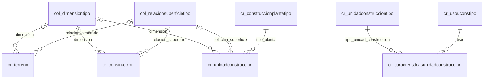
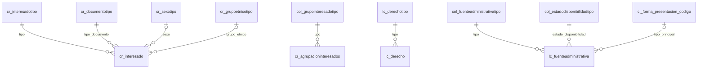

# Base podada: el levantamiento catastral sin las tablas vacías

La base original tiene 217 tablas porque ili2pg crea una por cada elemento del modelo LADM-COL, pero la carga solo llenó una parte: 117 están vacías. La **base podada** es una copia que conserva las 45 tablas que tienen los datos del levantamiento o que esos datos necesitan para leerse. No pierde ninguna fila y es la que conviene usar en el proyecto.

| | Base original | Base podada |
| --- | ---: | ---: |
| Tablas | 217 | 45 |
| Llaves foráneas | 528 | 77 |
| Filas en las tablas de datos | 410 171 | 410 171 |
| Tamaño en disco | 140 MB | 118 MB |

En esta carpeta:

| Archivo | Contenido |
| --- | --- |
| `README.md` | Este documento: el criterio de poda, qué queda y qué sale, cómo crear la base y su diagrama entidad-relación |
| [diccionario-de-datos.md](diccionario-de-datos.md) | Diccionario de datos de las 45 tablas: columnas, tipos, llaves, cuánto dato trae cada columna y valores de los dominios |
| [podar.sql](podar.sql) | Script que convierte una copia de la base original en la base podada |
| [diagrama-er.mmd](diagrama-er.mmd) | Diagrama entidad-relación completo, en Mermaid: las 45 tablas con sus columnas, los valores de los dominios y las llaves foráneas |
| [diagrama-er.png](diagrama-er.png), [diagrama-er.pdf](diagrama-er.pdf) | El mismo diagrama ya dibujado, como imagen y como PDF de una página |

Qué es la base original y de dónde sale su modelo está en el [README de `datos/`](../README.md).

## Criterio de poda

1. **Se eliminan las tablas vacías** (117). Son las de los modelos que se importaron sin datos (RIC, insumos del gestor catastral y de la SNR, cartografía) y las partes del modelo principal que este levantamiento no diligenció, como linderos, puntos y datos de contacto de los interesados.
2. **Se eliminan las tablas que quedan aisladas** (55): tienen contenido, pero ya ninguna tabla con datos catastrales se une con ellas. Son 47 dominios (listas de valores) que solo usaban tablas vacías y 8 tablas de metadatos de ili2db, que describen las 217 tablas del modelo completo.
3. **En las tablas que quedan se eliminan las columnas que apuntaban a tablas vacías** (34). Son llaves foráneas que, por eso mismo, están en `NULL` en todas las filas.

Todo lo demás queda igual: nombres, tipos, valores de `t_id`, llaves, índices y comentarios.

### Por qué no se rompe ninguna unión

- Una tabla vacía no aporta filas a ninguna consulta: toda unión que pase por ella ya devuelve cero filas en la base original.
- Las llaves foráneas de la base están todas validadas, así que una columna que apunta a una tabla vacía solo puede tener `NULL`. Se comprobó además contando: las 34 columnas eliminadas no tienen ningún valor.
- Se conservan las 28 llaves foráneas entre las 20 tablas de datos y las 28 que van de ellas a sus dominios. Las 20 tablas de datos forman un solo bloque conectado, como muestra el [diagrama](#diagrama-entidad-relación).
- No queda ninguna tabla vacía ni ninguna llave foránea que apunte a una tabla eliminada.

### Decisiones que se pueden cambiar

- **Metadatos de ili2db.** Sus 8 tablas de catálogo no están vacías, pero no se unen con nada y su contenido pasa a estar en este README y en el diccionario. Para conservarlas, `podar.sql` indica qué línea quitar.
- **Dominios sin uso.** Se conservan todos los dominios a los que apunta alguna columna de una tabla de datos, aunque tres de ellos no los use ninguna fila (ver el diccionario).
- **Columnas vacías.** Solo se eliminan las que apuntaban a tablas eliminadas. Quedan 24 columnas sin ningún dato: 14 de `extdireccion`, `fin_vida_util_version` en las 8 tablas que la tienen y 2 más. El diccionario las marca con 0 %.

## Qué queda y qué sale

| Modelo | Tablas en la original | Se conservan | Se eliminan |
| --- | ---: | ---: | ---: |
| Levantamiento Catastral (`lc_`, `cr_`), el modelo principal | 46 | 27 | 19 |
| Núcleo LADM-COL (`col_`, `ext`) | 51 | 16 | 35 |
| Registro de Información Catastral (`ric_`) | 42 | 0 | 42 |
| Insumos del gestor catastral (`gc_`) | 23 | 0 | 23 |
| Insumos de la SNR (`snr_`) | 22 | 0 | 22 |
| Integración de insumos (`ini_`) | 2 | 0 | 2 |
| Cartografía catastral (`cc_`) | 12 | 0 | 12 |
| Tipos de geometría (`gm_`) | 9 | 0 | 9 |
| Metadatos de ili2db (`t_ili2db_`) | 10 | 2 | 8 |
| **Total** | **217** | **45** | **172** |

### Las 45 tablas que quedan

**Tablas de datos (20).** Las filas son conteos exactos sobre la base original.

| Tabla | Tipo | Filas | Qué contiene |
| --- | --- | ---: | --- |
| `lc_predio` | Clase | 22 220 | Los predios |
| `lc_datosadicionaleslevantamientocatastral` | Clase | 22 220 | Datos de la visita y área registral de cada predio |
| `lc_contactovisita` | Clase | 8 948 | Quién atendió la visita |
| `lc_estructuranovedadnumeropredial` | Estructura | 15 079 | Cambios del número predial |
| `cr_datosphcondominio` | Clase | 838 | Áreas y unidades de los predios matrices en propiedad horizontal o condominio |
| `cr_predio_copropiedad` | Asociación | 14 567 | Qué unidad predial pertenece a qué predio matriz |
| `lc_predio_informalidad` | Asociación | 181 | Predios informales y el predio formal con el que se relacionan |
| `extdireccion` | Estructura | 22 220 | Dirección de cada predio |
| `col_uebaunit` | Asociación | 65 391 | Qué terreno, construcciones y unidades de construcción tiene cada predio |
| `cr_terreno` | Clase | 8 920 | Terrenos, con su geometría |
| `cr_construccion` | Clase | 13 528 | Construcciones, con su geometría |
| `cr_unidadconstruccion` | Clase | 42 988 | Unidades de construcción, con su geometría |
| `cr_caracteristicasunidadconstruccion` | Clase | 42 988 | Uso, tipo, año y áreas de cada unidad de construcción |
| `cr_interesado` | Clase | 16 579 | Personas naturales y jurídicas con derechos sobre los predios |
| `cr_agrupacioninteresados` | Clase | 6 142 | Grupos de interesados que comparten un derecho |
| `col_miembros` | Asociación | 18 482 | Qué interesado pertenece a qué agrupación y con qué participación |
| `lc_derecho` | Clase | 22 220 | El derecho de un interesado o una agrupación sobre un predio |
| `lc_fuenteadministrativa` | Clase | 22 220 | Documentos que sustentan los derechos |
| `col_rrrfuente` | Asociación | 22 220 | Qué fuente sustenta qué derecho |
| `col_unidadfuente` | Asociación | 22 220 | Qué fuente corresponde a qué predio |

**Dominios (23).** `ci_forma_presentacion_codigo`, `col_dimensiontipo`, `col_estadodisponibilidadtipo`, `col_fuenteadministrativatipo`, `col_grupointeresadotipo`, `col_relacionsuperficietipo`, `col_unidadadministrativabasicatipo`, `cr_construccionplantatipo`, `cr_documentotipo`, `cr_grupoetnicotipo`, `cr_interesadotipo`, `cr_sexotipo`, `cr_unidadconstrucciontipo`, `cr_usouconstipo`, `extdireccion_clase_via_principal`, `extdireccion_sector_ciudad`, `extdireccion_sector_predio`, `extdireccion_tipo_direccion`, `lc_condicionprediotipo`, `lc_derechotipo`, `lc_destinacioneconomicatipo`, `lc_estructuranovedadnumeropredial_tipo_novedad`, `lc_resultadovisitatipo`.

**Tablas de la carga (2).** `t_ili2db_basket` y `t_ili2db_dataset`. Se conservan porque la columna `t_basket` de todas las tablas de datos apunta a ellas.

### Las 172 tablas que salen

La lista completa, con el motivo de cada una, está en [podar.sql](podar.sql).

| Motivo | Tablas | Cuáles |
| --- | ---: | --- |
| Vacías | 117 | 73 clases, 24 estructuras y 20 asociaciones: todas las tablas de datos de `ric_`, `gc_`, `snr_`, `ini_`, `cc_` y `gm_`, 22 del núcleo y 15 del modelo principal |
| Dominios que ya nadie usa | 47 | Los 16 de `ric_`, 9 de `snr_`, 3 de `gc_`, 1 de `ini_`, 1 de `cc_`, 13 del núcleo y 4 del modelo principal |
| Metadatos de ili2db | 8 | `t_ili2db_attrname`, `t_ili2db_classname`, `t_ili2db_column_prop`, `t_ili2db_inheritance`, `t_ili2db_model`, `t_ili2db_settings`, `t_ili2db_table_prop`, `t_ili2db_trafo` |

Del modelo principal salen, por estar vacías: `cr_fuenteespacial`, `cr_lindero`, `cr_puntocontrol`, `cr_puntolindero`, `lc_interesadocontacto`, `lc_novedadfmi`, `extreferenciaregistralsistemaantiguo`, `lc_predio_ini_predioinsumos` y las siete tablas `lc_nu_*`.

### Columnas eliminadas

En el núcleo LADM-COL las relaciones se definen entre clases abstractas, así que sus tablas tienen una columna por cada clase concreta que puede participar. Las que corresponden a clases sin datos quedan en `NULL` y se eliminan.

| Tabla | Columnas eliminadas |
| --- | --- |
| `col_miembros` (3) | `interesado_ric_interesado`, `interesado_ric_agrupacioninteresados`, `agrupacion_ric_agrupacioninteresados` |
| `col_rrrfuente` (2) | `fuente_administrativa_ric_fuenteadministrativa`, `rrr_ric_derecho` |
| `col_uebaunit` (8) | `ue_ric_terreno`, `ue_ric_construccion`, `ue_ric_unidadconstruccion`, `ue_ric_nu_espaciojuridicoredservicios`, `ue_ric_nu_espaciojuridicounidadedificacion`, `ue_lc_nu_espaciojuridicoredservicios`, `ue_lc_nu_espaciojuridicounidadedificacion`, `baunit_ric_predio` |
| `col_unidadfuente` (2) | `fuente_administrativa_ric_fuenteadministrativa`, `unidad_ric_predio` |
| `cr_terreno` (2) | `nivel_lc_nu_nivel`, `nivel_ric_nu_nivel` |
| `cr_construccion` (2) | `nivel_lc_nu_nivel`, `nivel_ric_nu_nivel` |
| `cr_unidadconstruccion` (2) | `nivel_lc_nu_nivel`, `nivel_ric_nu_nivel` |
| `extdireccion` (10) | `extinteresado_ext_direccion_id`, `extunidadedificcnfsica_ext_direccion_id`, `lc_nu_spcjrdcrdsrvcios_ext_direccion_id`, `lc_n_spcjrdcndddfccion_ext_direccion_id`, `ric_predio_direccion`, `ric_terreno_ext_direccion_id`, `ric_construccion_ext_direccion_id`, `ric_unidadconstruccion_ext_direccion_id`, `ric_n_spcjrdcrdsrvcios_ext_direccion_id`, `ric_n_spcjrcndddfccion_ext_direccion_id` |
| `lc_derecho` (3) | `interesado_ric_interesado`, `interesado_ric_agrupacioninteresados`, `unidad_ric_predio` |

### Lo que el modelo permite y esta carga no trae

Estas relaciones existen en el modelo, pero sus tablas están vacías, así que no hay nada que consultar:

- Datos de contacto de los interesados (`lc_interesadocontacto`) y su dirección (`extinteresado`).
- Linderos y puntos del levantamiento (`cr_lindero`, `cr_puntolindero`, `cr_puntocontrol`) y las asociaciones que los unen con las unidades espaciales (`col_masccl`, `col_menosccl`, `col_puntoccl` y similares).
- Fuentes espaciales (`cr_fuenteespacial`) y archivos adjuntos de las fuentes (`extarchivo`).
- Novedades del folio de matrícula (`lc_novedadfmi`) y referencia registral del sistema antiguo (`extreferenciaregistralsistemaantiguo`).
- Niveles, áreas y volúmenes de las unidades espaciales (`lc_nu_nivel`, `col_areavalor`, `col_volumenvalor`).
- Emparejamiento del predio con los insumos del gestor catastral y de la SNR (`lc_predio_ini_predioinsumos`).

## Cómo crear la base podada

La forma más directa es **copiar la base completa y eliminar en la copia lo que sobra**. La base original no se modifica, y como el script solo elimina, todo lo que queda es idéntico al original.

Hace falta acceso a la base original, las herramientas de línea de comandos de PostgreSQL (`psql`, `pg_dump`, `createdb`) y un servidor con PostGIS y `uuid-ossp`. Los comandos suponen que la conexión ya está configurada; si no, hay que agregar `-h`, `-p` y `-U` a cada uno o definir `PGHOST`, `PGPORT` y `PGUSER`.

```bash
# 1. Copia completa de la base original en una base nueva
createdb catastro_pruned
pg_dump -d xtf2 | psql -q -d catastro_pruned

# 2. Poda de la copia
psql -d catastro_pruned -f datos/base-podada/podar.sql

# 3. Respaldo en SQL para compartir con el equipo (no va al repositorio)
pg_dump -d catastro_pruned --no-owner --no-privileges | gzip > catastro_pruned.sql.gz
```

El respaldo es un archivo de texto con las órdenes SQL que recrean la base, sin propietarios ni permisos, para que se restaure con cualquier usuario. Quien lo reciba lo restaura así:

```bash
createdb catastro_pruned
gunzip -c catastro_pruned.sql.gz | psql -q -d catastro_pruned
```

Para restaurarlo hace falta:

- Un servidor PostgreSQL 18 con PostGIS y `uuid-ossp` instalados. El respaldo crea las dos extensiones, pero no las instala.
- Usar `psql`, no la ventana de consultas de un cliente gráfico: el archivo trae órdenes propias de `psql` (`\restrict`, `COPY ... FROM stdin`). Tiene que ser un `psql` reciente; los anteriores a agosto de 2025 no conocen `\restrict`.

### Qué hace `podar.sql`

Trabaja en una sola transacción: si una comprobación falla, la base queda como estaba.

1. Se niega a ejecutarse sobre la base original (la reconoce por su nombre, `xtf2`).
2. Comprueba que el esquema `xtf` tiene exactamente las 217 tablas esperadas, que las 117 que da por vacías lo están y que las 34 columnas que va a eliminar no tienen ningún valor.
3. Elimina las 34 columnas y luego las 172 tablas. No usa `CASCADE`: si una tabla que se conserva dependiera todavía de una que se elimina, PostgreSQL se negaría.
4. Comprueba que quedan 45 tablas y 77 llaves foráneas, y avisa si alguna de las que quedan está vacía.
5. Fuera de la transacción, ejecuta `VACUUM (FULL, ANALYZE)` para recuperar el espacio.

### Qué se probó

- **Las listas del script contra la base real.** Las listas de tablas vacías, tablas de datos, dominios en uso, dominios sin uso y metadatos, la de las 34 columnas y la de las llaves foráneas que quedan coinciden exactamente con lo que da el catálogo de la base original (se compararon con una huella MD5 de cada lista).
- **El script, sobre un esqueleto.** Se ejecutó en un PostgreSQL 18.6 temporal, sobre una base con las mismas 217 tablas, las mismas 111 llaves foráneas de las tablas que se conservan y una fila de prueba en cada tabla no vacía. Terminó con 45 tablas y 77 llaves foráneas. También se probó que se detiene sin cambiar nada cuando una tabla "vacía" tiene una fila, cuando una columna "vacía" tiene un valor, cuando la base se llama `xtf2` y cuando se ejecuta por segunda vez, y que el respaldo en SQL de la base podada se restaura bien con los comandos de arriba.
- **El resultado, sobre la base real.** La base `catastro_pruned`, creada el 13 de octubre de 2026, se comparó con la original por dos conexiones de solo lectura:
  - Tiene las 45 tablas, las 77 llaves foráneas y las 222 columnas de datos esperadas: las huellas MD5 de esas tres listas coinciden con las de este documento y las del diccionario.
  - Sus filas son idénticas a las de la original. Se comparó una huella MD5 de cada fila, con las columnas que se conservan: 410 171 filas en las 20 tablas de datos, 272 en los 23 dominios y 2 en las tablas de la carga.
  - Conserva las 45 llaves primarias, los 124 índices de las tablas que quedan, los comentarios de tablas y columnas, los valores por defecto y las 4 columnas de geometría en EPSG:9377. Ninguna tabla quedó vacía y todas las llaves foráneas están validadas.

## Diagrama entidad-relación

Cada línea es una llave foránea: va de la tabla referenciada (izquierda) a la tabla que tiene la columna (derecha), y la etiqueta es el nombre de esa columna. `||` indica que la columna es obligatoria y `|o`, que admite `NULL`. Las columnas de cada tabla están en el [diccionario de datos](diccionario-de-datos.md).

### Diagrama completo, en un archivo aparte

[diagrama-er.mmd](diagrama-er.mmd) es el homólogo, para la base podada, del [diagrama de clases del modelo original](../modelos-ladm-col/documentacion/Modelo_Aplicacion_LADMCOL_Levantamiento_Catastral_V2_0.png): un solo diagrama con todo el modelo. Está dibujado en [diagrama-er.png](diagrama-er.png) y en [diagrama-er.pdf](diagrama-er.pdf). Es grande, como el original (unos 10 000 × 4 700 px), así que conviene abrirlo aparte y ampliarlo.

| Elemento | Qué muestra |
| --- | --- |
| Tablas de datos (amarillo) | Todas sus columnas: tipo, nombre, llave (`PK`, `FK`, `UK`) y obligatoriedad. `[1]` es obligatoria (`NOT NULL`) y `[0..1]` admite `NULL`. En las llaves foráneas, la flecha indica la tabla a la que apuntan |
| Dominios (blanco) | Sus valores, que son los códigos de la columna `ilicode`, como las enumeraciones del diagrama original. `cr_usouconstipo` tiene 102 y se resume por grupo; la lista completa está en el [diccionario](diccionario-de-datos.md#usos-de-la-unidad-de-construcción-cr_usouconstipo) |
| Tablas de la carga (gris) | `t_ili2db_basket` y `t_ili2db_dataset`, con sus columnas |
| Líneas | 57 llaves foráneas, con el nombre de la columna: 28 entre tablas de datos, 28 hacia los dominios y 1 entre las tablas de la carga. No se dibujan las 20 de `t_basket`, que tienen todas las tablas de datos |

Lo que dice el diagrama se comparó con el catálogo de `catastro_pruned`: las 230 columnas con su tipo, obligatoriedad y llaves, las 57 llaves foráneas y los valores de los dominios coinciden.

El archivo pide el motor de distribución ELK, que da un resultado más compacto. Donde no está disponible, Mermaid usa el suyo por defecto y el diagrama sale más ancho. Para volver a dibujar las imágenes después de editar el `.mmd` hace falta [Mermaid CLI](https://github.com/mermaid-js/mermaid-cli):

```bash
mmdc -i datos/base-podada/diagrama-er.mmd -o datos/base-podada/diagrama-er.png -w 10000 -H 4800 -b white
mmdc -i datos/base-podada/diagrama-er.mmd -o datos/base-podada/diagrama-er.pdf -w 3180 -H 1600 --pdfFit -b white
```

Los diagramas que siguen son vistas parciales del mismo modelo, sin columnas, para leer aquí mismo.

### Tablas de datos

```mermaid
erDiagram
    lc_predio ||--o{ lc_datosadicionaleslevantamientocatastral : "lc_predio"
    lc_datosadicionaleslevantamientocatastral ||--o{ lc_contactovisita : "lc_datos_adicionales"
    lc_datosadicionaleslevantamientocatastral |o--o{ lc_estructuranovedadnumeropredial : "lc_dtsdcnlstmntctstral_novedad_numeros_prediales"
    lc_predio ||--o{ cr_datosphcondominio : "lc_predio"
    lc_predio ||--o{ cr_predio_copropiedad : "matriz"
    lc_predio ||--o{ cr_predio_copropiedad : "unidad_predial"
    lc_predio ||--o{ lc_predio_informalidad : "lc_predio_formal"
    lc_predio ||--o{ lc_predio_informalidad : "lc_predio_informal"
    lc_predio |o--o{ extdireccion : "lc_predio_direccion"
    cr_terreno |o--o{ extdireccion : "cr_terreno_ext_direccion_id"
    cr_construccion |o--o{ extdireccion : "cr_construccion_ext_direccion_id"
    cr_unidadconstruccion |o--o{ extdireccion : "cr_unidadconstruccion_ext_direccion_id"
    lc_predio |o--o{ col_uebaunit : "baunit_lc_predio"
    cr_terreno |o--o{ col_uebaunit : "ue_cr_terreno"
    cr_construccion |o--o{ col_uebaunit : "ue_cr_construccion"
    cr_unidadconstruccion |o--o{ col_uebaunit : "ue_cr_unidadconstruccion"
    cr_construccion |o--o{ cr_unidadconstruccion : "cr_construccion"
    cr_caracteristicasunidadconstruccion ||--o{ cr_unidadconstruccion : "cr_caracteristicasunidadconstruccion"
    lc_predio |o--o{ lc_derecho : "unidad_lc_predio"
    cr_interesado |o--o{ lc_derecho : "interesado_cr_interesado"
    cr_agrupacioninteresados |o--o{ lc_derecho : "interesado_cr_agrupacioninteresados"
    cr_agrupacioninteresados |o--o{ col_miembros : "agrupacion_cr_agrupacioninteresados"
    cr_agrupacioninteresados |o--o{ col_miembros : "interesado_cr_agrupacioninteresados"
    cr_interesado |o--o{ col_miembros : "interesado_cr_interesado"
    lc_derecho |o--o{ col_rrrfuente : "rrr_lc_derecho"
    lc_fuenteadministrativa |o--o{ col_rrrfuente : "fuente_administrativa_lc_fuenteadministrativa"
    lc_predio |o--o{ col_unidadfuente : "unidad_lc_predio"
    lc_fuenteadministrativa |o--o{ col_unidadfuente : "fuente_administrativa_lc_fuenteadministrativa"
```



En palabras:

- Un **predio** (`lc_predio`) se une con su **terreno**, sus **construcciones** y sus **unidades de construcción** a través de `col_uebaunit`. Cada fila de esa tabla une el predio con una sola de esas unidades.
- Una unidad de construcción pertenece a una construcción y tiene un registro de características, donde están su uso y su tipo.
- Un **derecho** (`lc_derecho`) une un predio con un **interesado** o con una **agrupación de interesados**; los miembros de cada agrupación están en `col_miembros`.
- Las **fuentes administrativas** se unen con los derechos por `col_rrrfuente` y con los predios por `col_unidadfuente`.
- Los predios en propiedad horizontal o condominio se relacionan entre sí por `cr_predio_copropiedad` (predio matriz y unidad predial), y los informales con el formal por `lc_predio_informalidad`.
- Cada predio tiene sus **datos adicionales** del levantamiento y su **dirección** (`extdireccion`).
- Cuatro de estas llaves existen pero no tienen datos: las tres de `extdireccion` hacia terreno, construcción y unidad de construcción, e `interesado_cr_agrupacioninteresados` de `col_miembros`.

Un ejemplo que recorre la cadena principal, del predio a sus unidades de construcción:

```sql
SELECT p.numero_predial, u.t_id AS unidad, c.area_construida, uso.ilicode AS uso
FROM xtf.lc_predio p
JOIN xtf.col_uebaunit ub ON ub.baunit_lc_predio = p.t_id
JOIN xtf.cr_unidadconstruccion u ON u.t_id = ub.ue_cr_unidadconstruccion
JOIN xtf.cr_caracteristicasunidadconstruccion c ON c.t_id = u.cr_caracteristicasunidadconstruccion
JOIN xtf.cr_usouconstipo uso ON uso.t_id = c.uso;
```

### Dominios

Qué dominio usa cada tabla de datos. Los valores de cada dominio están en el [diccionario](diccionario-de-datos.md#dominios).

**Predio y dirección**

```mermaid
erDiagram
    col_unidadadministrativabasicatipo ||--o{ lc_predio : "tipo"
    lc_condicionprediotipo ||--o{ lc_predio : "condicion_predio"
    lc_destinacioneconomicatipo ||--o{ lc_predio : "destinacion_economica"
    lc_resultadovisitatipo ||--o{ lc_datosadicionaleslevantamientocatastral : "resultado_visita"
    cr_documentotipo |o--o{ lc_contactovisita : "tipo_documento_quien_atendio"
    lc_estructuranovedadnumeropredial_tipo_novedad ||--o{ lc_estructuranovedadnumeropredial : "tipo_novedad"
    extdireccion_tipo_direccion ||--o{ extdireccion : "tipo_direccion"
    extdireccion_clase_via_principal |o--o{ extdireccion : "clase_via_principal"
    extdireccion_sector_ciudad |o--o{ extdireccion : "sector_ciudad"
    extdireccion_sector_predio |o--o{ extdireccion : "sector_predio"
```



**Unidades espaciales**



**Interesados, derechos y fuentes**



Las asociaciones (`col_uebaunit`, `col_miembros`, `col_rrrfuente`, `col_unidadfuente`, `cr_predio_copropiedad`, `lc_predio_informalidad`) y `cr_datosphcondominio` no usan dominios. Además, las 20 tablas de datos apuntan con `t_basket` a `t_ili2db_basket`, que a su vez apunta a `t_ili2db_dataset`; esas 21 llaves no se dibujan.

## Antes de compartirla

La poda quita tablas, no anonimiza. La base podada sigue teniendo todo lo sensible de la original:

- **Datos personales.** `cr_interesado` y `lc_contactovisita` tienen documentos de identidad, nombres, teléfonos, correos y domicilios.
- **Identifica el municipio.** Lo delatan los códigos `departamento` y `municipio` de `lc_predio`, los primeros dígitos de `numero_predial`, el nombre del archivo de origen en `t_ili2db_dataset` y las propias geometrías.

Por eso ni la base ni su respaldo van al repositorio, que es público: el `.gitignore` excluye los respaldos (`*.sql.gz`, `catastro_*.sql`, `*.dump`, `*.backup`) y los archivos `.xtf`. El respaldo se comparte con el equipo por un canal privado.

## Pendientes

- **Decidir cómo recibe el equipo la base podada**: el respaldo por un canal privado o una versión anonimizada. Una opción intermedia es el archivo parquet de [predios/](../predios/README.md): no tiene datos personales, pero sigue identificando al municipio y tampoco es público.
- **Anonimizar** si los datos van a salir del equipo o a aparecer en un entregable: como mínimo, las tablas con datos personales y lo que identifica al municipio.
- **Decidir si se eliminan también las 24 columnas sin datos** y los tres dominios que ninguna fila usa.
